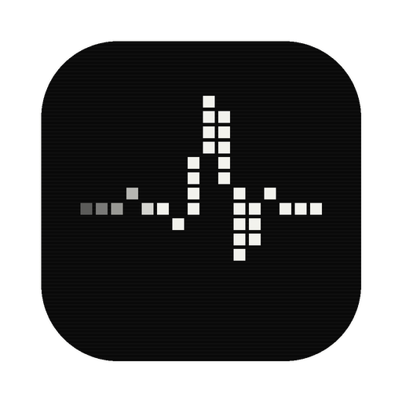

<div align="center">



# Pulse Explorer

**One app. Every file format. One consistent viewing experience.**

Privacy-first, local-first universal viewer for documents, spreadsheets, slides, code, media, eBooks, archives and raw binaries.

<br />


[Quick start](#-quick-start) · [Features](#-features) · [Architecture](#-architecture) · [Security](#-security) · [Scripts](#-scripts) · [Docs](#-documentation)

</div>

<br />

## ✦ Overview

Pulse Explorer (codename **OmniView**, hence the `@omniview/*` package scope) opens almost anything you throw at it, entirely on your machine. Drop in a PDF, a spreadsheet, a nested ZIP or an unknown binary and get a fast, consistent viewer with annotations that survive zoom and reload.

It runs in the browser and as a native desktop app (Tauri v2). An optional containerized worker adds high-fidelity conversion through LibreOffice and FFmpeg.

## ✦ Features

| | Category | Formats |
| :-: | --- | --- |
| 📄 | **Documents** | `pdf` `docx` `doc` `odt` `rtf` |
| 📊 | **Spreadsheets** | `xlsx` `xls` `ods` `csv` `tsv` |
| 🎞️ | **Presentations** | `pptx` `ppt` `odp` |
| 🖼️ | **Images & vector** | `png` `jpg` `webp` `gif` `bmp` `ico` `svg` (visual + XML source) |
| 📚 | **eBooks** | `epub` `fb2` |
| 💻 | **Code & config** | `ts` `js` `py` `go` `rs` `json` `yaml` `toml` `xml` `md` `html` `css` `sql` `sh` `ini` `log`, masked `.env` inspector |
| 🎧 | **Audio & video** | `mp4` `webm` `ogg` `mp3` `wav` `flac` `aac` with waveform and timecode markers |
| 🗜️ | **Archives** | `zip` `tar` `gz` `tgz` with a virtual tree and recursive inner-file preview |
| 🔍 | **Anything else** | Hex and ASCII inspector with offsets and a data inspector |

## ✦ Hold to convert

Press and hold any file in the library, dashboard or recents (touch or mouse, about half a second). A circle appears with the formats that file can become. **Drag onto one and let go**: the result is saved next to the original, in the same collection, and the original is never touched. Release on empty space to keep the circle open and tap instead, or use **Convert / Compress…** in the right-click menu for keyboard access.

Everything runs on your device. FFmpeg ships as WebAssembly inside the app, so nothing is uploaded or fetched from a CDN.

| From | To |
| --- | --- |
| Images (`png` `jpg` `webp` `bmp` `svg`) | other raster formats, PDF, or Compress (resize and re-encode) |
| PDF | PNG or JPG pages (ZIP if several), text, or Compress |
| `docx` `pptx` `xlsx` | text or PDF (text only, layout is not preserved), or Compress (repacks and shrinks embedded photos) |
| `csv` `tsv` `json` `yaml` `xlsx` `ods` | each other, with JSON minify |
| Audio and video | `mp3` `wav` `ogg` `flac` `m4a` `mp4` `webm`, or Compress |
| `zip` `tar` `tgz` | each other, or Compress |

**Compress** keeps the format and uses the level set in *Settings → Files* (Smallest, Balanced, Best). If a file can't get any smaller, it tells you instead of saving a bigger copy. Compressing a PDF at Smallest or Balanced flattens pages to images, so the text is no longer selectable; Best repacks losslessly.

**Also included**

- Annotations stored as zoom-invariant normalized (`0..1`) coordinates, cell references, line ranges and media timecodes
- Session continuity in IndexedDB, with optional sync to PostgreSQL
- Built-in sample gallery so you can try every viewer without any files

## ✦ Quick start

**Prerequisites**

- [Node.js](https://nodejs.org) 20 or newer
- [pnpm](https://pnpm.io) 11 (`corepack enable` picks up the pinned version)
- *Optional:* Docker for the full stack, [Tauri prerequisites](https://tauri.app/start/prerequisites/) for native desktop builds

```bash
git clone https://github.com/itsnothyun/Pulse-Explorer.git
cd Pulse-Explorer
pnpm install
pnpm dev
```

Open **http://localhost:5173**, then drag any file onto the window or pick one from the sample gallery.

<details>
<summary><b>Desktop app</b></summary>

```bash
pnpm desktop          # lightweight launcher (Windows: double-click OmniView-Desktop.cmd)
pnpm desktop:tauri    # native Tauri dev window (requires Rust)
pnpm desktop:build    # production bundle
```n
**Windows installer.** `pnpm desktop:build` compiles the web app and the Rust shell, then writes an NSIS installer to `apps/desktop/src-tauri/target/release/bundle/nsis/` (for example `Pulse Explorer_1.0.0_x64-setup.exe`). The first build downloads and compiles Rust crates and can take several minutes. The installer registers Pulse Explorer as an option in *Open with* for the supported file types. It isn't code-signed yet, so SmartScreen may ask you to confirm.


See [OFFLINE_SUPPORT_MATRIX.md](apps/desktop/OFFLINE_SUPPORT_MATRIX.md) for what works offline.
</details>

<details>
<summary><b>API, worker and backing services (optional)</b></summary>

```bash
docker compose -f infrastructure/compose.yaml up --build -d
```

| Service | Port | Override |
| --- | --- | --- |
| PostgreSQL 16 | 5432 | `POSTGRES_PORT` |
| Redis 7 | 6379 | `REDIS_PORT` |
| MinIO API / console | 9000 / 9001 | `MINIO_API_PORT` / `MINIO_CONSOLE_PORT` |
| Fastify API | 4000 | `API_PORT` |

Run services individually with `pnpm dev:api` and `pnpm dev:worker`, or everything at once with `pnpm dev:all`.
</details>

## ✦ Architecture

```text
apps/
├── web/               React + Tailwind + Zustand shell (Vite)
├── api/               Fastify REST API + Prisma
├── worker/            Sandboxed LibreOffice / FFmpeg conversion worker
└── desktop/           Tauri v2 desktop shell
packages/
├── shared-types/      Domain interfaces and DTOs
├── utilities/         Magic bytes, sanitizers, zip guard
├── viewer-core/       Adapter registry and session store
├── viewer-adapters/   Per-format rendering engines
├── ui/                Shared UI components
└── config/            Shared configuration
infrastructure/        Docker Compose and worker Dockerfile
docs/                  Architecture, security and roadmap specs
tests/                 Integration (Vitest) and e2e (Playwright)
```

Each format is a `ViewerAdapter` registered in `viewer-core`, so adding a format means adding one adapter. See the [rendering engine strategy](docs/03_RENDERING_ENGINE_STRATEGY.md) for the contract.

## ✦ Tech stack

| Layer | Built with |
| --- | --- |
| UI | React 19, Tailwind CSS 4, Zustand, Vite |
| Desktop | Tauri v2 (Rust), single-instance, native file associations, Quick View window |
| Rendering | pdf.js, SheetJS, JSZip, DOMPurify, marked |
| Conversion (on-device) | FFmpeg WebAssembly, pdf-lib, fflate, yaml, Canvas API |
| Optional backend | Fastify, Prisma, PostgreSQL, Redis, MinIO, LibreOffice worker |
| Tooling | pnpm workspaces, Turborepo, TypeScript, Vitest, Playwright |

## ✦ Privacy

- Files you open stay on your device. The web app and the desktop app work without an account and without network access to any Pulse service.
- Conversion and compression run locally. FFmpeg ships inside the app as WebAssembly; no CDN or server is contacted.
- The workspace (file bytes, annotations, history) is stored in your browser's IndexedDB. It is **not encrypted**, so use *Settings → Files → Clear workspace* on a shared computer.
- The optional API and cloud mode are off by default. Nothing syncs unless you switch the workspace to Cloud and run the backend yourself.

## ✦ Security

Files are treated as hostile by default.

| Threat | What Pulse Explorer does |
| --- | --- |
| Spoofed type (`.png` that is really an `.exe`) | Detects the real type from magic bytes, never the extension |
| Script in SVG, HTML, Markdown, EPUB, DOCX | DOMPurify sanitization before anything renders |
| Office macros and DDE formulas | Never executed; a notice is shown |
| Zip bombs and path traversal | 100:1 ratio ceiling, 1 GB expansion cap, and `..`, absolute and drive-letter paths rejected for zip **and** tar |
| Secrets in `.env` files | Masked in the viewer and blocked from remote upload |
| Malicious URLs on import | SSRF guard resolves DNS first and blocks loopback, link-local, private ranges and internal service names |
| Compromised conversion | Conversions run in the browser sandbox; the optional worker runs non-root with a read-only filesystem, all capabilities dropped and an isolated network |
| Desktop attack surface | Least-privilege Tauri capabilities and a strict CSP: no remote scripts, no frames, no plugins |

Converting or compressing never overwrites the original; results are always saved as new files.

Found a vulnerability? Please report it privately. See [SECURITY.md](SECURITY.md) for how, what's in scope, and the known limitations. The full threat model is in [05 Security architecture](docs/05_SECURITY_ARCHITECTURE.md).
## ✦ Scripts

| Command | Description |
| --- | --- |
| `pnpm dev` | Web app dev server |
| `pnpm dev:all` | All apps via Turborepo |
| `pnpm build` | Build every package and app |
| `pnpm typecheck` | Type-check the workspace |
| `pnpm test` | Run all Vitest tests |
| `pnpm test:unit` | Integration tests only |
| `pnpm fixtures:generate` | Generate sample files in `tests/fixtures/generated` |
| `pnpm test:e2e` | Playwright end-to-end tests |

First e2e run: `pnpm exec playwright install && pnpm fixtures:generate && pnpm test:e2e`

## ✦ Testing

```bash
pnpm typecheck                  # all workspaces
pnpm test                       # unit and integration (Vitest)
pnpm exec playwright test       # end-to-end in Chromium, including the hold-to-convert flows
```

The converter tests cover format round-trips, archive safety (zip-slip, long tar paths), and refusing to save a "compressed" file that isn't smaller.

## ✦ Troubleshooting

| Problem | Fix |
| --- | --- |
| `pnpm: command not found` | Run `corepack enable`, or `npm i -g pnpm` |
| Port 5173 is busy | Stop the other dev server; the port is fixed so tests and links stay stable |
| Hold-to-convert opens the file instead | Hold still for about half a second; moving more than a few pixels cancels the hold |
| A conversion says "Already as small as it can get" | The file has no more to give at this level; try *Smallest* in Settings |
| Video conversion is slow | FFmpeg runs as WebAssembly in the browser. Use the desktop app, shorter clips, or the *Smallest* level |
| `desktop:build` fails | Install the [Tauri prerequisites](https://tauri.app/start/prerequisites/) (Rust and the Windows build tools) |

## ✦ Contributing

Issues and pull requests are welcome. Please run `pnpm typecheck` and `pnpm test` before opening a PR, keep new dependencies justified, and read [SECURITY.md](SECURITY.md) before touching file parsing, sanitization or Tauri permissions. Never report vulnerabilities in a public issue.
## ✦ Documentation

| | |
| --- | --- |
| [00 Project overview](docs/00_PROJECT_OVERVIEW.md) | [04 Database design](docs/04_DATABASE_DESIGN.md) |
| [01 System architecture](docs/01_SYSTEM_ARCHITECTURE.md) | [05 Security architecture](docs/05_SECURITY_ARCHITECTURE.md) |
| [02 Tech stack and licenses](docs/02_TECH_STACK_AND_LICENSES.md) | [06 Implementation roadmap](docs/06_IMPLEMENTATION_ROADMAP.md) |
| [03 Rendering engine strategy](docs/03_RENDERING_ENGINE_STRATEGY.md) | [Desktop offline matrix](apps/desktop/OFFLINE_SUPPORT_MATRIX.md) |

<br />

<div align="center">
<sub>Built with care for people who open too many file types.</sub>
</div>