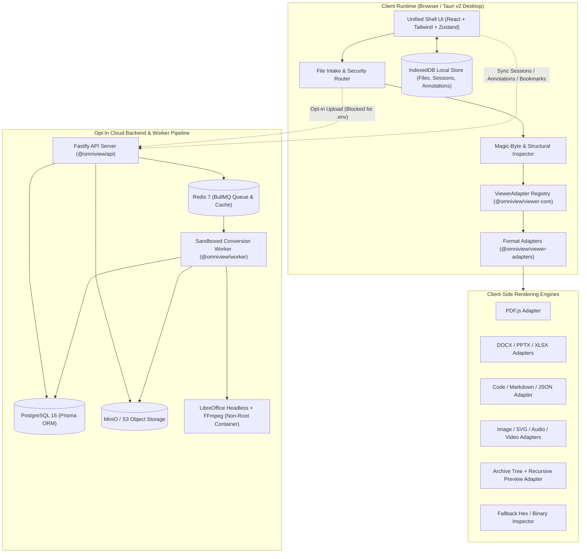
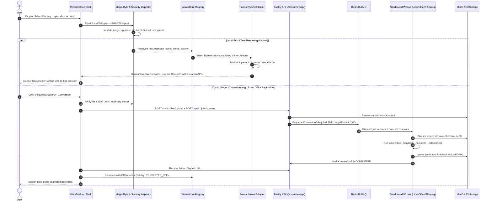

# OmniView — System Architecture

---

## 1. High-Level System Architecture

OmniView is architected as a **hybrid local-first + cloud-augmented platform**. The client application (`@omniview/web` and `@omniview/desktop`) contains a self-contained file detection and rendering runtime capable of operating 100% offline. When connected to the backend (`@omniview/api` + `@omniview/worker`), it seamlessly upgrades to support persistent workspaces, multi-device session continuity, and containerized headless office/media conversions.



---

## 2. File Intake, Detection & Rendering Sequence

The following sequence diagram illustrates both the **Local-First Fast Path** and the **Opt-In Cloud High-Fidelity Conversion Path**:



---

## 3. Monorepo Package Boundaries

OmniView uses an npm workspaces / TypeScript project-references monorepo structure under `omniview/`:

```text
omniview/
├── packages/
│   ├── shared-types/      # @omniview/shared-types
│   ├── utilities/         # @omniview/utilities
│   ├── viewer-core/       # @omniview/viewer-core
│   └── viewer-adapters/   # @omniview/viewer-adapters
├── apps/
│   ├── web/               # @omniview/web
│   ├── api/               # @omniview/api
│   ├── worker/            # @omniview/worker
│   └── desktop/           # @omniview/desktop
├── infrastructure/
│   ├── compose.yaml
│   └── docker/
│       └── Dockerfile.worker
└── docs/
```

### Package Responsibility Matrix

| Package | Layer | Dependencies Allowed | Primary Responsibilities |
| :--- | :--- | :--- | :--- |
| `@omniview/shared-types` | Foundation | Zero runtime dependencies | Canonical TypeScript interfaces for `FileDescriptor`, `FileFamily`, `FidelityTier`, `ViewerCapabilities`, `ViewerAdapter`, `AnnotationRecord`, `BookmarkRecord`, `ConversionJobDTO`, and API payloads. |
| `@omniview/utilities` | Core Library | `@omniview/shared-types` | Magic-byte signature inspection, SHA-256 hashing, UTF-8 vs binary heuristics, Zip-Bomb ratio & path traversal validators, `.env` secret parser/redactor, SVG/HTML sanitizer, normalized coordinate math, byte formatting. |
| `@omniview/viewer-core` | Engine Kernel | `@omniview/shared-types`, `@omniview/utilities` | `AdapterRegistry` with priority resolution, lifecycle state machine (`IDLE` -> `DETECTING` -> `MOUNTING` -> `READY` -> `ERROR`), unified search coordinator, zoom/pan state controller, and local IndexedDB persistence manager. |
| `@omniview/viewer-adapters` | Format Renderers | `@omniview/shared-types`, `@omniview/utilities`, `@omniview/viewer-core`, format libs | Concrete implementations of `ViewerAdapter` for PDF, DOCX, PPTX, XLSX/CSV, Images/SVG, EPUB/FB2, Code/Markdown/JSON/YAML/XML/ENV, Audio/Video, Archives (`.zip`/`.tar`), and the Fallback Hex Inspector. |
| `@omniview/web` | Frontend App | `@omniview/*` client packages, React, Zustand, Tailwind | Unified application shell, drag-and-drop workspace, split-pane comparison view, command palette (`Ctrl+K`), outline/bookmarks/annotations sidebar, nested archive breadcrumb navigation, and accessibility bindings. |
| `@omniview/api` | Backend Service | `@omniview/shared-types`, `@omniview/utilities`, Fastify, Prisma, BullMQ | RESTful API for workspace files, version history, annotations, bookmarks, viewer session state, SSRF-protected remote URL fetching, S3 pre-signed URLs, and conversion job orchestration. |
| `@omniview/worker` | Background Worker | `@omniview/shared-types`, `@omniview/utilities`, BullMQ | Sandboxed queue consumer executing headless LibreOffice (`soffice`) and FFmpeg inside ephemeral `tmpfs` directories with strict timeouts and resource caps. |
| `@omniview/desktop` | Native Wrapper | `@omniview/web`, Tauri v2 (Rust) | Native OS file associations, zero-copy local file streaming, OS window controls, offline-guaranteed execution without browser memory ceilings. |

---

## 4. Local-First Execution vs. Opt-In Cloud Pipeline

### 4.1 Local-First Execution Guarantee
- By default, `@omniview/web` boots in **Local Workspace Mode**.
- Dropping a file creates a browser `File` handle, inspects the header slice (`file.slice(0, 4096)`) to determine magic bytes, computes a SHA-256 fingerprint for local caching, and mounts the matching `ViewerAdapter` directly in the browser.
- Annotations, bookmarks, and last-viewed page/scroll positions are automatically saved in IndexedDB keyed by the file's SHA-256 fingerprint so reopening the same file restores the user's exact workspace state offline.

### 4.2 Opt-In Cloud Conversion Pipeline
- Complex legacy documents (e.g., heavily styled `.pptx` with SmartArt, legacy binary `.doc`/`.xls`/`.ppt`, or multi-section `.docx` requiring exact page numbering) can optionally be sent to the `@omniview/worker` pipeline.
- The worker converts the source file into a standardized **PDF/A preview artifact** (`PreviewArtifacts` table) and streams it back to the client's `PDFAdapter`, upgrading the viewport badge from `SEMANTIC_STRUCTURED` to `CONVERTED_PDF`.
