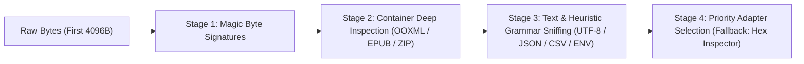

# OmniView — Rendering Engine Strategy & ViewerAdapter Contract

---

## 1. The `ViewerAdapter` Contract

Every format renderer in OmniView implements the unified `ViewerAdapter` interface defined in `@omniview/shared-types`. This guarantees that the host shell (`@omniview/web` / `@omniview/desktop`) never needs format-specific conditionals to drive search, zoom, navigation, outlines, or annotations.

```typescript
export interface ViewerAdapter {
  /** Unique identifier (e.g., 'pdf-native', 'docx-mammoth', 'xlsx-grid', 'hex-fallback') */
  readonly id: string;
  /** Human-readable display name */
  readonly name: string;
  /** Adapter resolution priority (higher wins; Hex fallback is -100) */
  readonly priority: number;
  /** Declared fidelity level provided by this adapter */
  readonly fidelity: FidelityTier;
  /** Capabilities supported by this adapter */
  readonly capabilities: ViewerCapabilities;

  /**
   * Deterministic predicate inspecting magic bytes, structural hints, and extension.
   */
  canHandle(descriptor: FileDescriptor): boolean;

  /**
   * Mounts the document into the provided container or returns structured render state,
   * exposing standardized controllers for the shell.
   */
  mount(context: ViewerMountContext): Promise<MountedViewerInstance>;
}
```

### Standardized Sub-Controllers

Each `MountedViewerInstance` exposes modular controllers:
- **`SearchController`**: `search(query, options) -> Promise<SearchMatch[]>`, `nextMatch()`, `prevMatch()`, `clearSearch()`.
- **`NavigationController`**: `goToPage(pageNumber)`, `goToOutlineItem(id)`, `getOutline() -> OutlineNode[]`, `setZoom(scale)`.
- **`AnnotationController`**: Renders and captures annotations in normalized coordinates, cell references, line ranges, or media timestamps.
- **`Lifecycle`**: `destroy() -> Promise<void>` — Deterministically revokes `ObjectURL`s, terminates Web Workers, and releases canvas memory to prevent leaks across rapid file switches.

---

## 2. Priority Resolution & Magic-Byte Inspection Pipeline

OmniView never trusts file extensions alone (e.g., a `.png` file renamed to `.pdf` or a `.zip` disguised as `.docx`). Every file goes through a 4-stage inspection pipeline in `@omniview/utilities`:



1. **Stage 1 — Binary Magic Signatures**:
   - `%PDF-` (`25 50 44 46 2D`) -> PDF
   - `\x89PNG\r\n\x1a\n` -> PNG Image
   - `FF D8 FF` -> JPEG Image
   - `RIFF....WEBP` -> WebP Image
   - `GIF87a` / `GIF89a` -> GIF Image
   - `PK\x03\x04` -> PKZIP Container (proceeds to Stage 2)
   - `D0 CF 11 E0 A1 B1 1A E1` -> OLE2 Compound Document (`.doc`, `.xls`, `.ppt`)
   - `1F 8B` -> GZIP Archive
   - `ID3` / `fLaC` / `OggS` / `ftyp` -> Audio/Video Media

2. **Stage 2 — PKZIP Sub-Format Disambiguation**:
   - Inspects Central Directory / local file headers without extracting full payloads:
     - Contains `word/document.xml` -> `DOCX`
     - Contains `ppt/presentation.xml` -> `PPTX`
     - Contains `xl/workbook.xml` -> `XLSX`
     - Contains `META-INF/container.xml` or `mimetype` (`application/epub+zip`) -> `EPUB`
     - Contains `content.xml` + OpenDocument manifest -> `ODT` / `ODS` / `ODP`
     - Otherwise -> Generic `ZIP` Archive

3. **Stage 3 — Text vs. Binary & Structured Grammar Detection**:
   - Checks for null bytes (`0x00`) and invalid UTF-8 sequences in the first 4 KB.
   - If valid UTF-8/UTF-16 text:
     - Checks filename/content for `.env` (`KEY=VALUE` secret patterns) -> activates **Local-Only Security Lock**.
     - Checks XML/SVG root tags (`<svg`, `<?xml`, `<FictionBook`) -> `SVG` / `XML` / `FB2`.
     - Validates JSON/YAML/TOML/CSV/Markdown/Source Code grammars.

4. **Stage 4 — Fallback Guarantee**:
   - Any file that fails Stages 1–3 or encounters a corrupt container during adapter mount automatically falls back to `HexViewerAdapter` (`priority: -100`), guaranteeing **zero unhandled crashes**.

---

## 3. Normalized Coordinate System (`0..1`) for Zoom-Invariant Annotations

To ensure highlights, pins, and rectangular notes remain anchored at the exact visual position regardless of viewport resize, DPI scaling, or zoom level (`25%` to `400%`), OmniView uses a **Normalized Page-Relative Coordinate System**:

$$\text{normX} = \frac{x_{\text{px}}}{\text{pageWidth}_{\text{px}}}, \quad \text{normY} = \frac{y_{\text{px}}}{\text{pageHeight}_{\text{px}}}, \quad \text{normW} = \frac{w_{\text{px}}}{\text{pageWidth}_{\text{px}}}, \quad \text{normH} = \frac{h_{\text{px}}}{\text{pageHeight}_{\text{px}}}$$

All four values (`normX`, `normY`, `normW`, `normH`) are constrained to the closed interval $[0.0, 1.0]$.

### Multi-Modal Anchor Polymorphism
While paginated and visual formats use normalized `(0..1)` bounding boxes, non-paginated formats use format-native deterministic anchors stored in the same `AnnotationAnchor` discriminated union:
- **Paginated / Visual (`PDF`, `PPTX`, `Image`, `SVG`)**: `{ type: 'NORMALIZED_RECT', pageIndex: number, x: number, y: number, width: number, height: number }`
- **Spreadsheets (`XLSX`, `CSV`, `TSV`)**: `{ type: 'CELL_RANGE', sheetName: string, startCol: number, startRow: number, endCol: number, endRow: number }`
- **Code & Text (`TS`, `JSON`, `MD`, `LOG`)**: `{ type: 'LINE_RANGE', startLine: number, startColumn: number, endLine: number, endColumn: number }`
- **Audio & Video (`MP4`, `MP3`, `WAV`)**: `{ type: 'TIMECODE_RANGE', startTimeMs: number, endTimeMs: number }`
- **Binary / Hex (`Fallback`)**: `{ type: 'BYTE_RANGE', startOffset: number, endOffset: number }`

---

## 4. Format-by-Format Rendering & Fallback Rules

### 4.1 PDF (`PdfViewerAdapter`)
- **Primary Engine**: Mozilla `pdfjs-dist` rendering to high-DPI `<canvas>` with an aligned transparent SVG/DOM text layer and interactive outline/bookmark tree.
- **Performance**: Virtualized page rendering (only active page $\pm 2$ buffer pages rendered at full resolution; thumbnails rendered lazily via `IntersectionObserver`).
- **Corrupt PDF Fallback**: If trailer/xref reconstruction fails, offers raw text extraction + Hex Inspector view.

### 4.2 Word Documents (`DocxViewerAdapter`)
- **Primary Client Engine**: `mammoth` converts `word/document.xml` into semantic HTML (`<h1>`–`<h6>`, `<table>`, `<p>`, embedded base64 images), sanitized through `DOMPurify`.
- **Outline Generation**: Automatically builds a navigable Table of Contents from heading elements.
- **High-Fidelity Upgrade**: When connected to `@omniview/worker`, users can toggle **Exact Layout Mode**, which dispatches a headless LibreOffice job to render a pixel-exact PDF/A artifact.

### 4.3 Presentations (`PptxViewerAdapter`)
- **Primary Client Engine**: Inspects `ppt/slides/slide*.xml` and `ppt/notesSlides/notesSlide*.xml` via `JSZip`, extracting slide titles, bullet hierarchies, shapes, embedded media relationships (`_rels`), and speaker notes into a 16:9 aspect-ratio slide stage with filmstrip navigation.
- **High-Fidelity Upgrade**: Optional worker conversion via LibreOffice Impress to PDF/A for complex vector animations and SmartArt.

### 4.4 Spreadsheets & Delimited Data (`SpreadsheetViewerAdapter`)
- **Primary Client Engine**: `xlsx` (SheetJS) for `.xlsx`/`.xls`/`.ods` and `papaparse` worker streaming for `.csv`/`.tsv`.
- **Virtualization**: Renders a sticky-header virtualized 2D data grid supporting 100,000+ rows at 60 FPS, multi-sheet tab bar, column sorting, cell formula inspection bar, and cell-coordinate search.
- **Security**: Evaluates cached values (`cell.v` / `cell.w`); never executes VBA macros (`vbaProject.bin` is flagged in a warning banner and ignored).

### 4.5 Images & Vector Graphics (`ImageSvgViewerAdapter`)
- **Raster (`.png`, `.jpg`, `.webp`, `.gif`, `.bmp`, `.ico`)**: Hardware-accelerated pan/zoom stage, checkerboard transparency toggle, 90° rotation, pixel dimension & EXIF/color metadata sidebar.
- **Vector (`.svg`)**: Parsed and sanitized through strict DOMPurify rules (`FORBID_TAGS: ['script', 'foreignObject', 'iframe', 'object', 'embed']`, `FORBID_ATTR: ['onload', 'onerror', 'onclick']`) plus dual-mode toggle between **Visual Vector Canvas** and **Formatted XML Source View**.

### 4.6 eBooks (`EpubFb2ViewerAdapter`)
- **EPUB**: Extracts `META-INF/container.xml` -> `.opf` manifest & spine order -> renders chapters sequentially in a sandboxed, sanitized typography container with adjustable font size, sepia/dark reading themes, and NCX/nav Table of Contents.
- **FB2**: Parses XML `<FictionBook>` `<description>` (cover, authors, annotation) and `<body>` sections into semantic chapters.

### 4.7 Code, Structured Data & `.env` (`CodeTextViewerAdapter`)
- **Code & Config**: Syntax-highlighted view with line numbers, minimap/fold indicators, word-wrap toggle, and regex search.
- **Structured Data (`.json`, `.yaml`, `.xml`)**: Dual-tab toggle between **Collapsible Tree Explorer** and **Raw Formatted Source**.
- **Markdown (`.md`)**: Split/toggle view between **Sanitized Rendered Preview** (GFM tables, task lists, code blocks) and **Raw Markdown Source**.
- **`.env` Files**: Parsed into a structured `KEY` / `VALUE` table with **Values Masked by Default (`••••••••`)**, individual eye-icon reveal toggles, and a mandatory **Local-Only Security Banner** blocking remote upload.

### 4.8 Audio & Video (`MediaViewerAdapter`)
- **Video (`.mp4`, `.webm`, `.ogg`)**: Frame-accurate scrubber, playback speed controls (`0.5x`–`2.0x`), Picture-in-Picture, and timecoded bookmark/annotation markers on the timeline.
- **Audio (`.mp3`, `.wav`, `.flac`, `.aac`)**: Web Audio API `OfflineAudioContext` amplitude waveform visualizer with click-to-seek and timecode range annotations.

### 4.9 Archives (`ArchiveViewerAdapter`)
- **Supported**: `.zip`, `.tar`, `.gz`, `.tgz`.
- **Virtual Tree Explorer**: Displays directory hierarchy, uncompressed size, compressed size, compression ratio, and modification timestamp without extracting the entire archive upfront.
- **Recursive Inner-File Viewing**: Clicking any file inside an archive extracts *only* that entry into an in-memory `Uint8Array` (after checking zip-bomb limits) and pushes it onto the **OmniView Breadcrumb Navigation Stack**, opening the inner file in its native adapter (e.g., viewing a `.pdf` or `.json` inside a `.zip`).

### 4.10 Fallback Hex & Binary Inspector (`HexViewerAdapter`)
- **Universal Safety Net**: Displays 16 bytes per row with 8-digit hexadecimal offset (`0x00000000`), grouped hex octets, and printable ASCII representation (`.` for non-printable bytes `< 0x20` or `> 0x7E`).
- **Capabilities**: Virtualized scrolling for multi-megabyte binaries, hex byte pattern search (`FF D8 FF`), ASCII string search, and endianness data inspector (Int8, UInt8, Int16, Int32, Float32 at selected offset).
