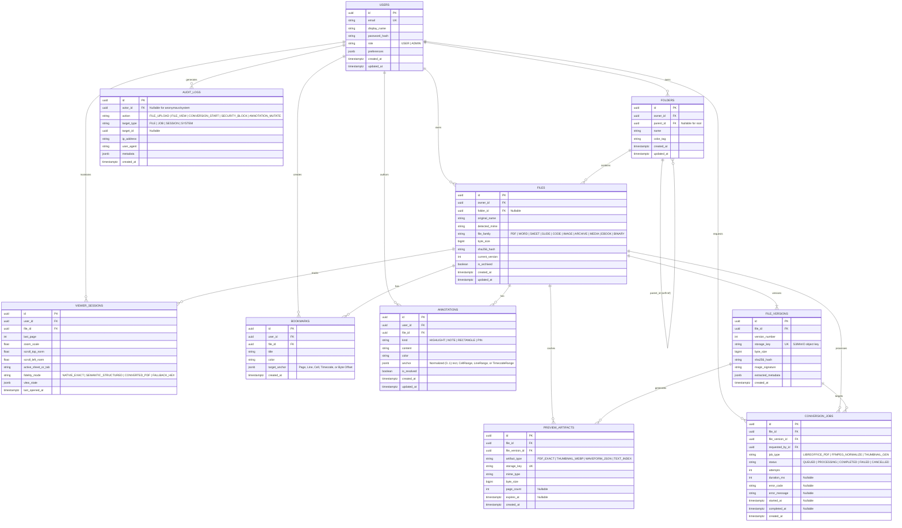

# OmniView — Database Design & Persistence Schema

---

## 1. Entity-Relationship Diagram

The cloud persistence layer uses **PostgreSQL 16** managed via **Prisma ORM**. All primary keys use UUIDv4 (`uuid`), timestamps are stored in UTC (`TIMESTAMPTZ`), and structured metadata/anchors leverage indexed `JSONB` columns.



---

## 2. Table Specifications & Indexing Strategy

### 2.1 `Users`
Stores authenticated workspace accounts and global viewer preferences (default theme, default zoom mode, preferred Office rendering fidelity).
- **Indexes**: `UNIQUE(email)`

### 2.2 `Folders`
Hierarchical virtual directory structure supporting arbitrary nesting.
- **Indexes**: `INDEX(owner_id, parent_id)`, `UNIQUE(owner_id, parent_id, name)`
- **Cascade Rule**: `ON DELETE SET NULL` for child `parent_id` or soft-archive propagation.

### 2.3 `Files` & `FileVersions`
Separates logical file identity (`Files`) from immutable content snapshots (`FileVersions`). Deduplication or integrity verification is powered by `sha256_hash`.
- **Indexes**:
  - `Files`: `INDEX(owner_id, folder_id)`, `INDEX(sha256_hash)`, `INDEX(file_family)`
  - `FileVersions`: `UNIQUE(file_id, version_number)`, `UNIQUE(storage_key)`

### 2.4 `PreviewArtifacts`
Caches derived outputs generated by `@omniview/worker` (e.g., `PDF_EXACT` produced by LibreOffice from a `.docx`/`.pptx`, `WAVEFORM_JSON` produced by FFmpeg, or page thumbnails).
- **Indexes**: `UNIQUE(file_version_id, artifact_type)`
- **Cache Hit Behavior**: Before enqueueing a new `ConversionJob`, the API checks if a `PreviewArtifact` already exists for `(file_version_id, 'PDF_EXACT')`. If present, it returns the cached artifact immediately in $<15\text{ms}$.

### 2.5 `ViewerSessions`
Persists per-user, per-file reading state so reopening a document on any device restores the exact page, scroll ratio (`0.0`–`1.0`), zoom level, active spreadsheet tab, or archive path.
- **Indexes**: `UNIQUE(user_id, file_id)`, `INDEX(user_id, last_opened_at DESC)`

### 2.6 `Bookmarks` & `Annotations`
Stores user-created navigational markers and visual/contextual annotations.
- **Anchor Schema (`JSONB`)**:
  ```json
  {
    "type": "NORMALIZED_RECT",
    "pageIndex": 3,
    "x": 0.142,
    "y": 0.285,
    "width": 0.410,
    "height": 0.032
  }
  ```
- **Indexes**: `INDEX(file_id, user_id)`, `GIN(anchor)` for fast page/sheet filtering.

### 2.7 `ConversionJobs`
Tracks asynchronous BullMQ worker execution state, retry counts, execution duration, and failure diagnostics.
- **Indexes**: `INDEX(status, created_at)`, `INDEX(file_version_id)`

### 2.8 `AuditLogs`
Append-only security and compliance log recording file uploads, conversions, and security policy triggers (such as blocked zip bombs, blocked SSRF URLs, or stripped SVG scripts).
- **Indexes**: `INDEX(actor_id, created_at DESC)`, `INDEX(action, created_at DESC)`
