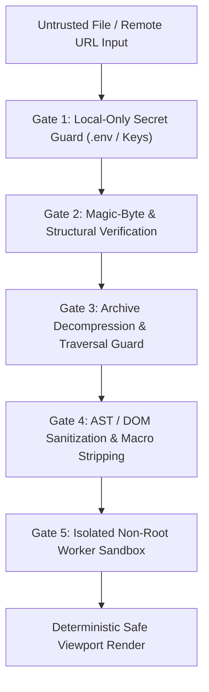

# OmniView — Security Architecture & Threat Model

---

## 1. Threat Model Overview

A universal file viewer is one of the highest-value targets in application security because its primary function is to parse complex, untrusted binary and markup formats originating from external sources. OmniView enforces a **Zero-Trust Defense-in-Depth Architecture** across both the client browser/desktop runtime and the server conversion pipeline.

---

## 2. Core Threat Vectors & Mitigations

### 2.1 Spoofed MIME Types & Polyglot Files
- **Threat**: An attacker renames an executable, HTML XSS payload, or SVG script as `invoice.pdf` or `photo.jpg` hoping the browser or server trusts the extension or `Content-Type` header.
- **Mitigation**:
  1. File routing ignores browser-supplied `file.type` when a magic-byte signature conflict exists.
  2. `@omniview/utilities` inspects the first 4,096 bytes for canonical magic signatures (`%PDF-`, `\x89PNG`, `PK\x03\x04`, etc.) and validates internal container structures (`word/document.xml`, `xl/workbook.xml`).
  3. All S3/MinIO downloads from `@omniview/api` serve raw files with `Content-Disposition: attachment` and `X-Content-Type-Options: nosniff` so the browser never directly executes uploaded files outside the OmniView sandbox.

### 2.2 Stored & DOM-Based XSS via SVG, HTML, Markdown, EPUB, and DOCX
- **Threat**: Malicious `.svg` files containing `<script>`, `onload="..."`, or `<foreignObject><iframe src="javascript:..."/>`; malicious `.md`, `.epub`, or `.docx` files containing injected `` payloads.
- **Mitigation**:
  1. Every markup-based adapter (`ImageSvgViewerAdapter`, `DocxViewerAdapter`, `MarkdownAdapter`, `EpubFb2ViewerAdapter`) routes output through a centralized **Strict Sanitizer** (`sanitizeUntrustedMarkup` in `@omniview/utilities`).
  2. Disallowed elements (`<script>`, `<foreignObject>`, `<iframe>`, `<object>`, `<embed>`, `<applet>`, `<meta>`, `<link>`, `<base>`, `<form>`) are unconditionally stripped.
  3. All `on*` event attributes (`onload`, `onerror`, `onclick`, `onmouseover`), `javascript:` / `vbscript:` / `data:text/html` URIs, and external `<use href="http...">` references are removed.
  4. Content Security Policy (CSP) headers on `@omniview/web` enforce `script-src 'self'; object-src 'none'; base-uri 'none'`.

### 2.3 Office Macro Execution (`.docm`, `.xlsm`, `.pptm`, OLE2 VBA)
- **Threat**: Malicious VBA macros, DDE (`Dynamic Data Exchange`) formulas (`=CMD|'/c calc'!A0`), or ActiveX controls embedded in Office files.
- **Mitigation**:
  1. Client-side adapters (`Mammoth`, `SheetJS`, custom `PPTX` XML parser) operate strictly on declarative XML/cell-value data structures and **have zero VBA or macro execution capability**.
  2. If `vbaProject.bin` or DDE formula tokens are detected inside the container, OmniView displays a prominent **Security Notice Banner** (`"Macros detected and neutralized — rendered in safe read-only mode"`) and logs a `SECURITY_BLOCK` event.
  3. Server-side LibreOffice conversion runs with `--headless --norestore --nolockcheck` and macros disabled in the container configuration.

### 2.4 Archive Decompression Bombs (Zip Bombs) & Path Traversal (`Zip Slip`)
- **Threat**:
  - A 42 KB `.zip` file (`42.zip`) that decompresses to 4.5 PB, exhausting RAM or disk space.
  - Archive entries named `../../../../etc/cron.d/pwn` or `C:\Windows\System32\evil.dll`.
- **Mitigation**:
  1. **Compression Ratio Ceiling**: Any entry or archive whose `uncompressedSize / compressedSize > 100` (configurable default `100:1`) is immediately rejected with `ERR_ZIP_BOMB_RATIO_EXCEEDED`.
  2. **Absolute Byte & Entry Ceilings**:
     - Max entries inspected per archive: `10,000` entries.
     - Max single extracted inner file size for recursive viewing: `50 MB`.
     - Max total cumulative uncompressed archive size: `500 MB`.
     - Max recursive archive nesting depth (`.zip` inside `.zip`): `3 levels`.
  3. **Path Traversal Sanitization**: Entry paths are normalized; any entry containing `..` segments, leading slashes (`/`, `\`), drive letters (`C:`), or null bytes is flagged as unsafe and blocked from extraction.

### 2.5 Accidental Cloud Exposure of `.env` & Secret Files
- **Threat**: Developers frequently inspect `.env`, `.env.local`, `.pem`, or `.key` files during debugging. Automatically uploading these files to a cloud backend would leak production API keys and database credentials.
- **Mitigation**:
  1. `@omniview/utilities` marks `.env*`, `.pem`, `.key`, and `.p12` files with `localOnlyGuard: true`.
  2. In the UI, `.env` values are **masked by default (`••••••••`)** with per-key reveal toggles.
  3. Both the client API client and the `@omniview/api` server reject any upload or conversion request for files flagged as `localOnlyGuard`, returning `403 ERR_LOCAL_ONLY_SENSITIVE_FILE`.

### 2.6 Server-Side Request Forgery (SSRF) on Remote URL Imports
- **Threat**: A user supplies a remote file URL pointing to internal cloud metadata or private infrastructure (`http://169.254.169.254/latest/meta-data/`, `http://127.0.0.1:6379/`, `http://10.0.0.5:5432/`).
- **Mitigation**:
  1. Remote URL fetching in `@omniview/api` validates scheme (`https:` or `http:` only; blocks `file:`, `ftp:`, `gopher:`, `data:`).
  2. Resolves DNS prior to connection and blocks all loopback (`127.0.0.0/8`, `::1`), link-local (`169.254.0.0/16`, `fe80::/10`), RFC-1918 private networks (`10.0.0.0/8`, `172.16.0.0/12`, `192.168.0.0/16`), and internal Docker service hostnames (`postgres`, `redis`, `minio`, `worker`).
  3. Enforces a strict `10 second` timeout, disables automatic redirects to private IPs, and caps response body streams at `100 MB`.

### 2.7 Hardened Non-Root Conversion Containers (`omniview-worker`)
- **Threat**: A memory corruption vulnerability in LibreOffice or FFmpeg triggered by a malformed document during server-side conversion.
- **Mitigation** (enforced in `infrastructure/compose.yaml` and `Dockerfile.worker`):
  1. Runs as an unprivileged user (`uid: 10001`, `omniview`).
  2. Root filesystem mounted **read-only** (`read_only: true`).
  3. Ephemeral scratch workspace mounted as memory-bounded `tmpfs` (`/tmp/omniview-work:size=512m,noexec,nosuid,nodev`), wiped immediately after each job in a `finally` block.
  4. Linux kernel capabilities dropped (`cap_drop: [ALL]`) and privilege escalation disabled (`security_opt: [no-new-privileges:true]`).
  5. Strict per-job process timeout (`30,000 ms` `SIGKILL`), CPU limit (`2.0` cores), and memory limit (`1024M`).
  6. Isolated internal Docker bridge network with no outbound internet routing required for conversion workers.
