# OmniView — Phased Implementation Roadmap & Verification Matrix

---

## 1. Delivery Overview

OmniView is engineered across **10 structured phases (Phase 0 through Phase 9)**, progressing from architectural specifications and foundational shared packages to specialized format adapters, unified shell UX, cloud backend/worker pipelines, desktop packaging, and automated end-to-end verification.

```mermaid
flowchart LR
    P0["Phase 0: Docs & Infra"] --> P1["Phase 1: Shared Types & Utilities"]
    P1 --> P2["Phase 2: Viewer Core & Adapter Registry"]
    P2 --> P3["Phase 3: Document & Data Adapters"]
    P3 --> P4["Phase 4: Media, Code, Archive & Hex Adapters"]
    P4 --> P5["Phase 5: Unified Web Shell & Annotations"]
    P5 --> P6["Phase 6: Fastify API & Prisma Schema"]
    P6 --> P7["Phase 7: Sandboxed Conversion Worker"]
    P7 --> P8["Phase 8: Tauri v2 Desktop Wrapper"]
    P8 --> P9["Phase 9: Security, Unit & E2E Verification"]
```

---

## 2. Phase-by-Phase Deliverables & Acceptance Criteria

### Phase 0: Architecture Documentation & Container Infrastructure
- **Scope**:
  - Complete `docs/00_PROJECT_OVERVIEW.md` through `docs/06_IMPLEMENTATION_ROADMAP.md`.
  - Author `infrastructure/compose.yaml` (PostgreSQL 16, Redis 7, MinIO, API, hardened Worker).
  - Author `infrastructure/docker/Dockerfile.worker` (non-root LibreOffice + FFmpeg container).
  - Author root `README.md`.
- **Acceptance Criteria**:
  - All architectural diagrams (`flowchart`, `sequenceDiagram`, `erDiagram`) validate cleanly.
  - Worker container specification enforces `read_only`, `tmpfs`, `cap_drop: ALL`, and `no-new-privileges`.

### Phase 1: Monorepo Foundation, `@omniview/shared-types` & `@omniview/utilities`
- **Scope**:
  - Root `package.json`, `tsconfig.base.json`, Vitest test runner configuration.
  - `@omniview/shared-types`: Complete domain models for files, adapters, capabilities, normalized annotations, bookmarks, sessions, and conversion jobs.
  - `@omniview/utilities`: Magic-byte inspector, PKZIP sub-format detector, UTF-8 vs binary heuristics, Zip-Bomb ratio & path traversal guard, SVG/HTML sanitizer, `.env` parser & masking utility, SSRF URL validator, and normalized coordinate math.
- **Acceptance Criteria**:
  - 100% TypeScript strict compilation (`tsc --noEmit`) with zero errors.
  - Unit tests verifying magic-byte detection across PDF, PNG, JPEG, GIF, WEBP, ZIP, DOCX, PPTX, XLSX, EPUB, GZIP, MP3, MP4, UTF-8 text, `.env`, and unknown binary payloads.

### Phase 2: `@omniview/viewer-core` Kernel & Persistence Engine
- **Scope**:
  - `AdapterRegistry`: Priority-based adapter registration, lookup, and automatic fallback to `HexViewerAdapter`.
  - `ViewerSessionManager`: Local persistence of recent files, scroll/page/zoom state, bookmarks, and normalized annotations using IndexedDB (`idb`) with deterministic in-memory fallback for headless/SSR environments.
  - Unified Search & Zoom state controllers.
- **Acceptance Criteria**:
  - Registry deterministically selects the highest-priority adapter capable of handling any `FileDescriptor` and falls back to `HexViewerAdapter` when no specialized adapter matches.

### Phase 3: Document, Presentation & Spreadsheet Adapters (`@omniview/viewer-adapters`)
- **Scope**:
  - `PdfViewerAdapter`: PDF rendering, page navigation, outline extraction, and full-text search.
  - `DocxViewerAdapter`: Client-side `.docx` structural HTML rendering via Mammoth + DOMPurify, heading outline extraction, and search.
  - `PptxViewerAdapter`: Client-side `.pptx` slide XML parser extracting slides, text boxes, speaker notes, and slide navigation.
  - `SpreadsheetViewerAdapter`: `.xlsx`/`.xls`/`.ods`/`.csv`/`.tsv` parsing via SheetJS & Papa Parse with multi-sheet tabs, formula bar inspection, and virtualized grid model.
- **Acceptance Criteria**:
  - Each adapter implements `canHandle`, `mount`, `SearchController`, `NavigationController`, `AnnotationController`, and `destroy`.

### Phase 4: Media, Code, Archive, eBook & Fallback Hex Adapters (`@omniview/viewer-adapters`)
- **Scope**:
  - `ImageSvgViewerAdapter`: Raster pan/zoom/rotate + sanitized SVG visual & source inspector.
  - `EpubFb2ViewerAdapter`: EPUB OPF spine reader & FB2 XML chapter reader.
  - `CodeTextViewerAdapter`: Syntax-highlighted code viewer, JSON/YAML/XML collapsible tree explorer, Markdown preview, and masked `.env` key-value inspector.
  - `MediaViewerAdapter`: Audio/video player with waveform synthesis and timecode annotations.
  - `ArchiveViewerAdapter`: `.zip`/`.tar`/`.gz` virtual tree explorer with Zip-Bomb protection and recursive inner-file extraction.
  - `HexViewerAdapter`: 16-byte row offset/hex/ASCII inspector with byte-sequence search and endianness data inspector.
- **Acceptance Criteria**:
  - Malicious SVG payloads (`<script>`, `foreignObject`, `onerror`) are neutralized before mount.
  - Recursive archive inspection extracts inner files cleanly while blocking `../` path traversal and >100:1 compression ratios.

### Phase 5: `@omniview/web` Unified Application Shell
- **Scope**:
  - Modern dark/light responsive shell with drag-and-drop file intake, sample file gallery (pre-loaded PDF, DOCX, PPTX, XLSX, CSV, SVG, JSON, Markdown, `.env`, ZIP with nested files, Audio, and Binary fixtures for immediate zero-setup testing), split-view comparison mode, command palette (`Ctrl+K`), search bar, zoom controls, fidelity badge, breadcrumb stack for nested archives, and interactive annotations/bookmarks/metadata sidebars.
- **Acceptance Criteria**:
  - Users can open, search, zoom, annotate, bookmark, and switch between all supported formats within a single cohesive interface.

### Phase 6: `@omniview/api` Backend Service & Prisma Database Layer
- **Scope**:
  - Prisma schema (`schema.prisma`) implementing all 10 tables defined in `04_DATABASE_DESIGN.md`.
  - Fastify server with health checks, file metadata CRUD, `.env` upload blocker, SSRF-guarded remote URL inspector, session/annotation/bookmark sync endpoints, and conversion job dispatch endpoints.
- **Acceptance Criteria**:
  - API integration tests verify `.env` upload rejection (`403`), SSRF private IP rejection (`400`/`403`), and annotation/session persistence.

### Phase 7: `@omniview/worker` Sandboxed Conversion Pipeline
- **Scope**:
  - BullMQ worker service executing headless LibreOffice (`soffice --headless --norestore --nolockcheck --convert-to pdf`) and FFmpeg inside ephemeral temporary directories with strict timeout and cleanup guarantees.
- **Acceptance Criteria**:
  - Worker job handler validates input paths, enforces execution timeouts, and cleans up scratch directories on both success and failure.

### Phase 8: `@omniview/desktop` Tauri v2 Native Packaging
- **Scope**:
  - Tauri v2 configuration (`tauri.conf.json`, `Cargo.toml`, `src/main.rs`) wrapping `@omniview/web` with native file dialog and OS file-association capabilities.
- **Acceptance Criteria**:
  - Desktop configuration validates and shares the exact `@omniview/web` bundle.

### Phase 9: Comprehensive Security, Unit & End-to-End Verification
- **Scope**:
  - Automated Vitest test suites covering utilities, security guards, adapter registry, every format adapter, API endpoints, and UI workflows.
  - Full production build verification (`npm run build`).
- **Acceptance Criteria**:
  - 100% of unit, security, and integration tests pass with zero unhandled errors.
