# Proof run: terminal, agents and Mac tools (2026-11-24)

Run on the Mac build of `feat/macos-desktop` (macOS 26.6.2, MacBook Pro M1 Pro, 16 GB). Every screenshot is the real app,
driven with real key and mouse events. `fakeagent` is a small stand-in agent (it draws a spinner for 4 s, then asks and
rings the bell), registered through *Settings › Terminal › More agents* for the run, so the agent states can be shown
without spending a real agent's tokens. Claude Code 2.1.330 and Antigravity 1.4.12 were tried separately (clean screen,
titled `claude` / `agy`).

| # | Shows | |
|---|---|---|
| 01 | A new terminal tab: the PULSE welcome card, the folder's Git state and scripts, the box prompt with its hint | 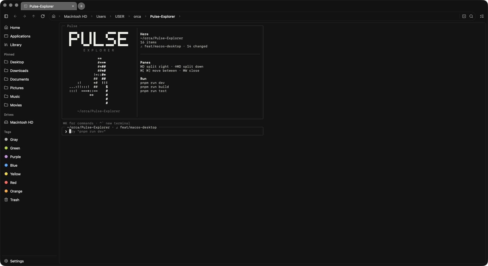 |
| 02 | An agent at work: the screen cleared for it, the tab marked ◌ | 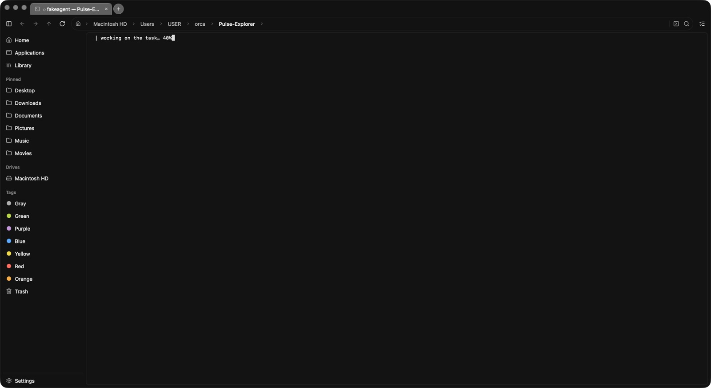 |
| 03 | The agent asks: the tab marked ◐ | 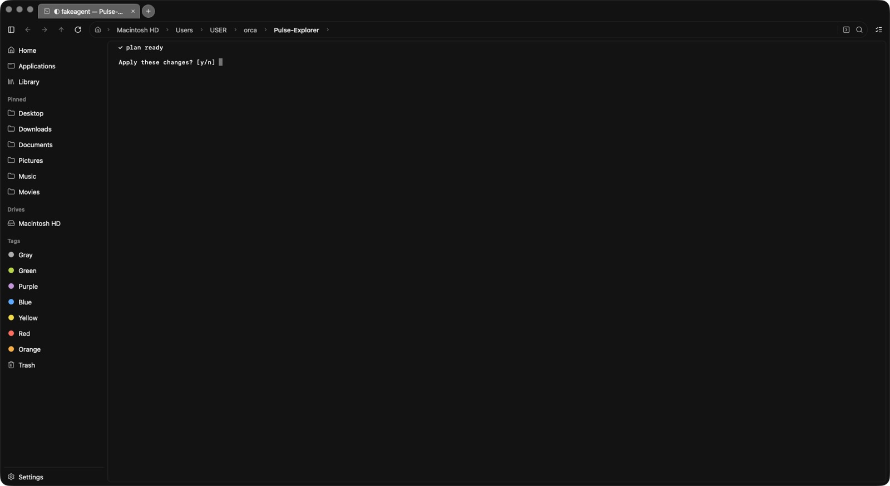 |
| 04 | *Window › Agents*: the agent listed as waiting, with its folder | 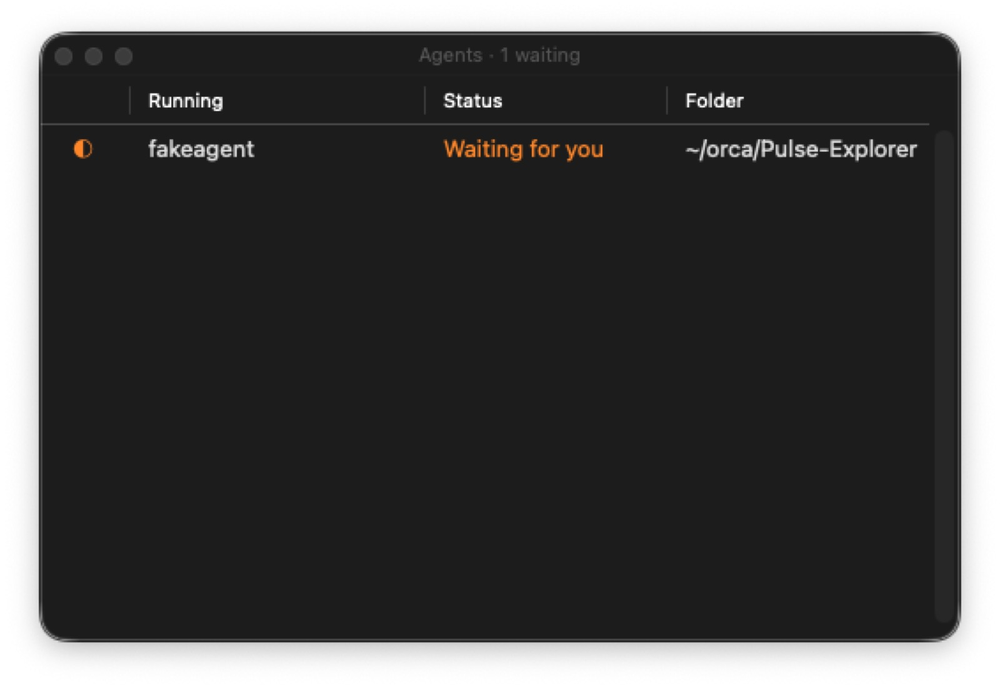 |
| 05 | The agent waiting in a background tab: macOS asks whether Pulse may send notifications (first use) | 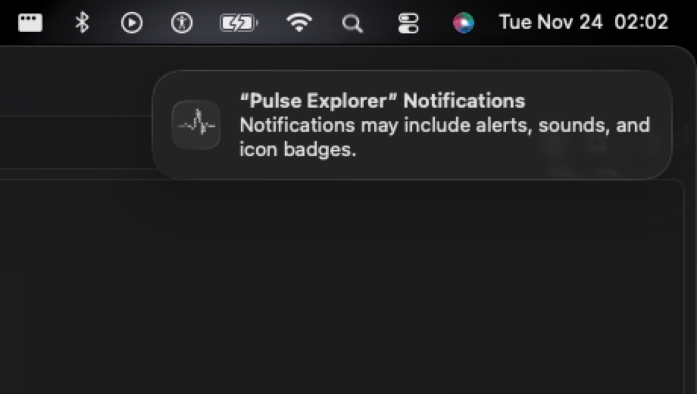 |
| 06 | The background tab keeps its ◐ mark while another tab is in front | 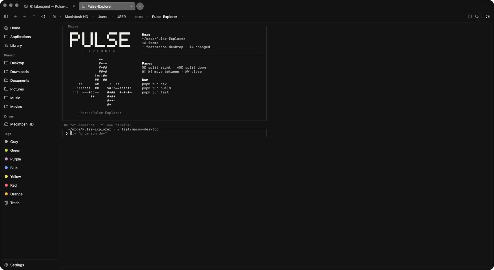 |
| 07 | `⌘`-click on a path in the output: README.md in Quick View | 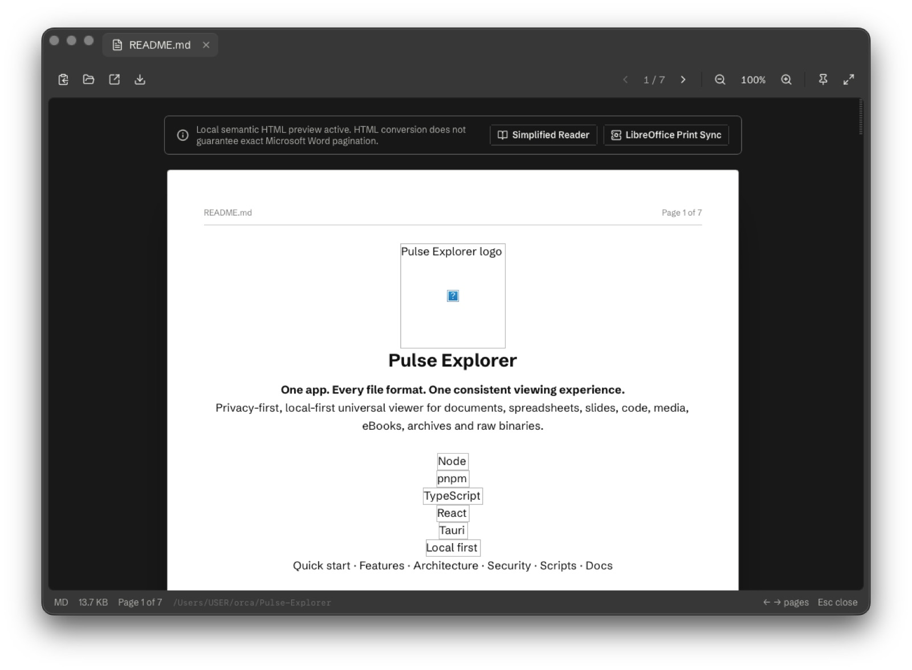 |
| 08 | `⌘F` in a terminal: the find bar, "README" found after 300 lines of output | 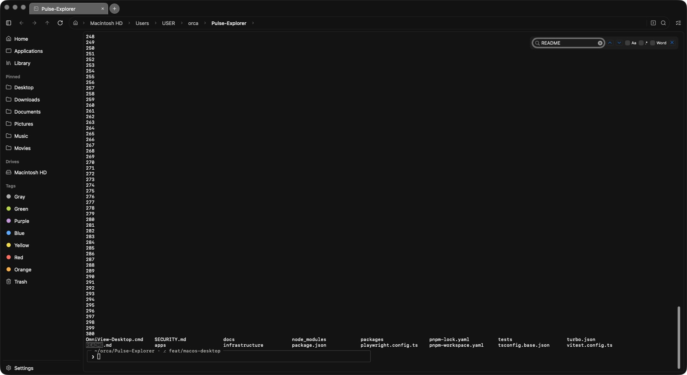 |
| 09 | *Settings › Terminal* | 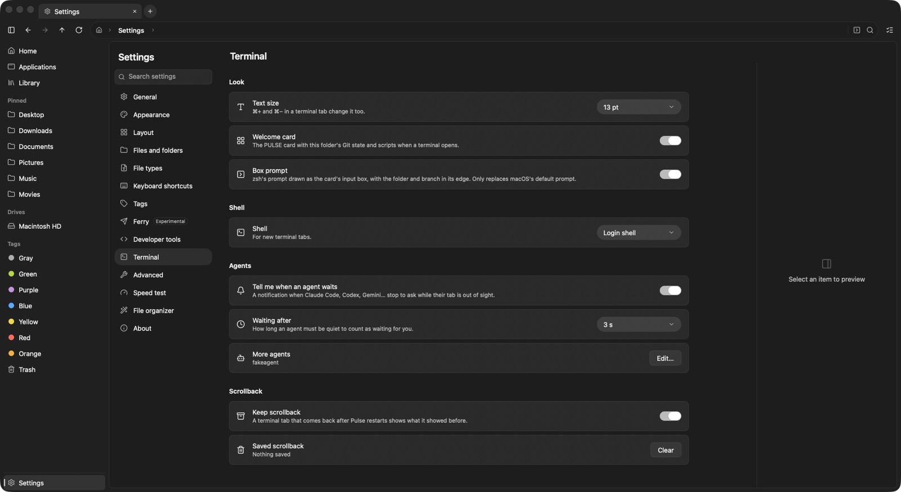 |
| 10 | A folder's menu: *Open terminal here* with the other tools | 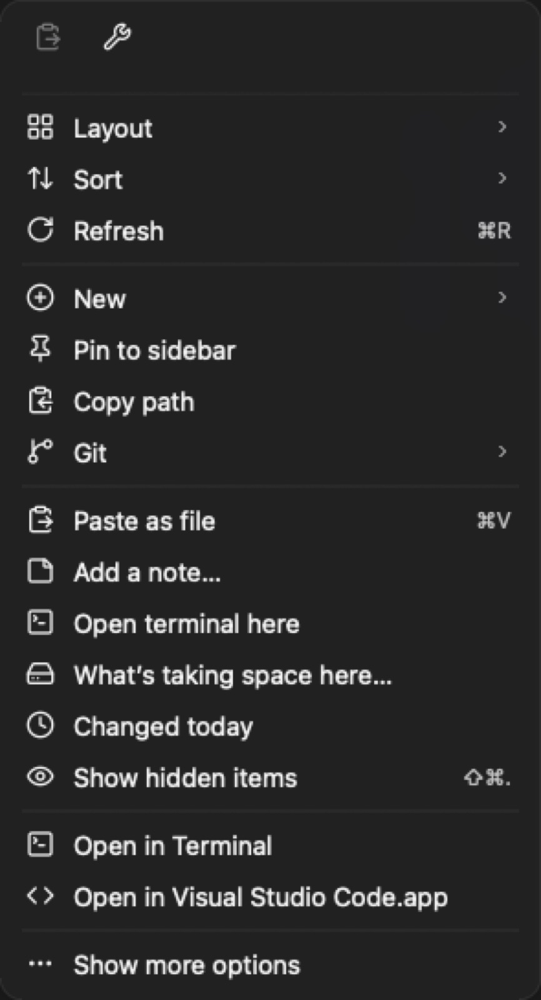 |
| 11 | After `⌘Q` and a relaunch: the tab's earlier output, a "restored" line, a new shell | 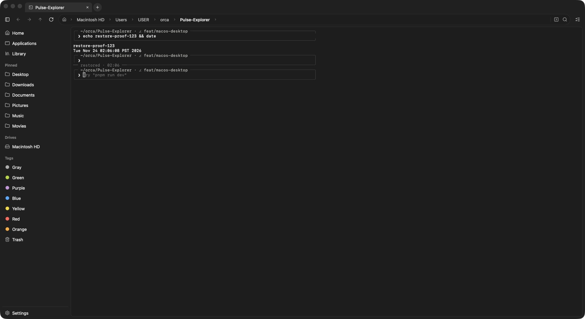 |
| 12 | Stress: four agents waiting at once in the Agents panel | 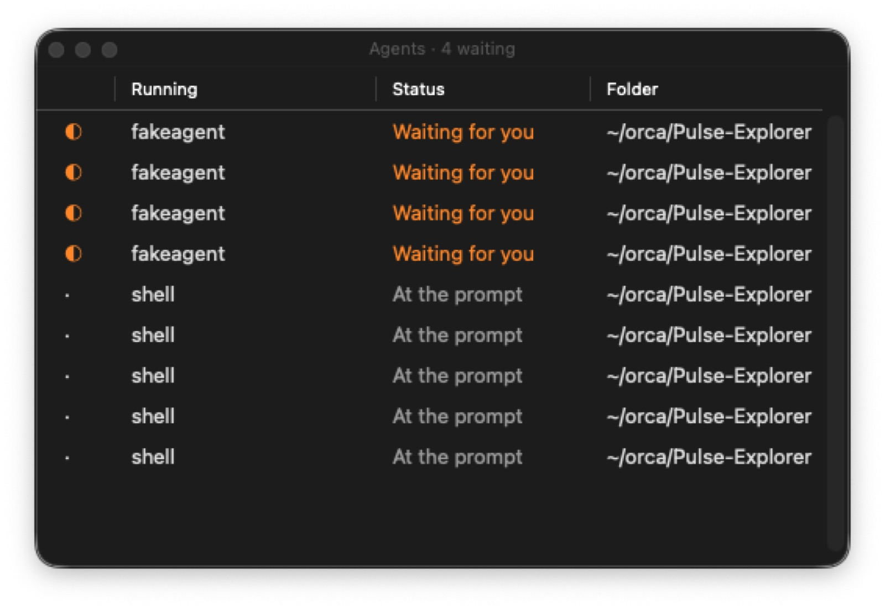 |
| 13 | Stress: nine terminal tabs, four of them agents (◐) | 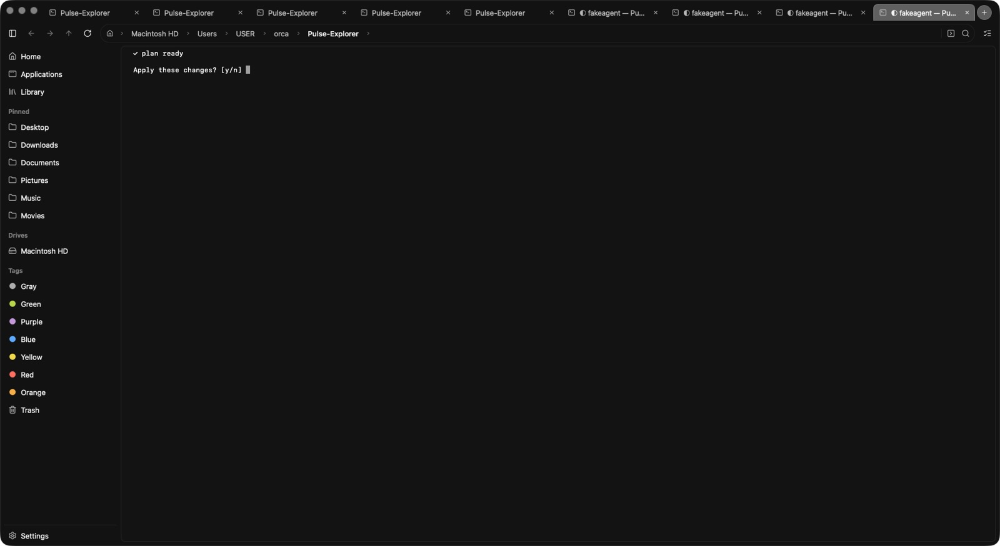 |

## Stress

Nine terminal tabs in one window: four printing `seq 1 400000` at once (1.6 million lines), four running the agent.

| | |
|---|---|
| File manager memory (phys_footprint) | 39 MB before, 78 MB at the peak of the flood, 60 MB settled |
| CPU | 5–6 % during the flood, 0 % after |
| Tab switching | 10 switches in 1.84 s, AppleScript's own overhead included |
| Agents panel | all four agents ◐ waiting, five shells at the prompt |

Each pane keeps at most 256 KB of output for a restore; the terminal's own scrollback is SwiftTerm's.

## Tests

- `swift test` in `apps/files/macos`: 51 tests (PulseKit: naming, clipboard, image tools on real `sips`, text recognition on
  real Vision, disk lens, folder notes, workspaces, project scripts, changed today, shelf, process inspection on a real pty,
  the welcome card at every width from 20 to 160 columns and its animation frames, the zsh prompt and agent detection on a
  real zsh, agent status, bell scanning, the scrollback ring).
- `pnpm vitest run` at the root: the web app's tests (player export arguments run through native ffmpeg among them).
- CI builds the Windows app (`.github/workflows/build.yml`).

## Not shown

- Dragging a file onto a terminal (the path quoting it uses is tested; a cross-window drag was not driven).
- The notification itself: it needs *Allow* in the permission prompt (05) first.
- Bare file names in output (`README.md` with no `/`) are not links for SwiftTerm; paths with a `/` (absolute, `./…`, `~/…`, `dir/file:12`) are.
